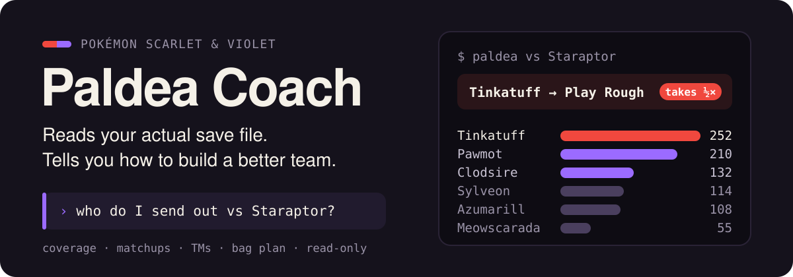
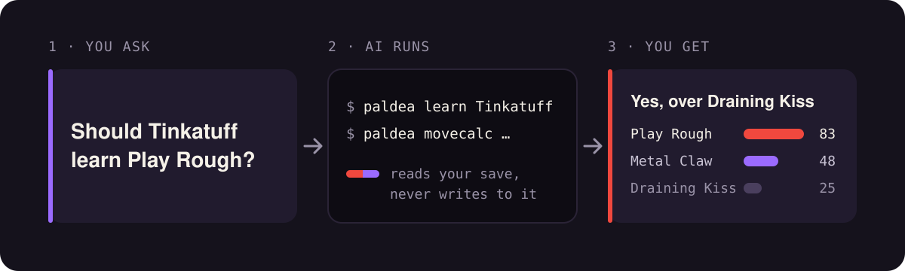

<p align="center">
  
</p>

<p align="center">
  <a href="https://github.com/tristanbatchler/PaldeaCoach/actions/workflows/build.yml"></a>
  
  
  
  
</p>

<p align="center">
  <a href="#ask-your-ai">Ask your AI</a> ·
  <a href="#quick-start">Quick start</a> ·
  <a href="#commands">Commands</a> ·
  <a href="#phone-ui">Phone UI</a> ·
  <a href="#how-it-works">How it works</a>
</p>

**Paldea Coach** reads your Pokémon Scarlet/Violet save (party, boxes, bag, TM recipes) and answers the
questions you'd otherwise squint at type charts for: where your **type coverage** has gaps, **who to send out**
against an opponent, which **TMs** to teach or craft, who should eat your **Exp. Candies**, and which
**held items** help most.

## Ask your AI

<p align="center">
  
</p>

Open this repo in an AI coding assistant ([Claude Code](https://claude.com/claude-code), Codex, Cursor, …)
and ask in plain English. [`AGENTS.md`](AGENTS.md) teaches it which commands answer which questions and what
the numbers mean. The tool never writes to your save, so the assistant can run it freely.

| You ask | It runs |
|---|---|
| *"What's my party's coverage like? How can I improve it?"* | `coverage` → `whatif` on the best candidates |
| *"Should Tinkatuff learn Play Rough?"* | `learn Tinkatuff` → `movecalc` vs its current moves |
| *"Which items should I give my Pokémon to maximise my team score?"* | `bagplan` |
| *"I'm about to fight Larry. Who do I send out against Staraptor?"* | `vs Staraptor` |
| *"What TMs can I craft right now?"* | `craft` |

<details>
<summary><b>Real answers</b> from a Lv34–39 playthrough (Meowscarada, Tinkatuff, Azumarill, Sylveon, Clodsire, Pawmot)</summary>

> **"What is the coverage of my party like? How can I improve it?"**
>
> Your attacks are excellent: something on your team hits 802 of 814 Pokémon super-effectively (99%). The
> weak spot is defence. Ground is the big one: Tinkatuff, Clodsire and Pawmot are all weak to it, and only
> Meowscarada resists it. Poison and Fire are also uncovered. Your team score is 82.5. The best fix is a
> Fire/Flying Pokémon in place of Sylveon (+12.7), and you already have one: your boxed Oricorio. Others
> that work are Talonflame (Fletchling line) or Charizard. A Water/Flying like Pelipper or Gyarados comes close (+12.0).
> If you'd rather keep everyone, Rock is the most useful attack type you're missing (+10 species).

> **"Should Tinkatuff learn Play Rough?"**
>
> Yes, definitely. Replace Draining Kiss with it.
>
> | Move | Avg. damage |
> |---|---|
> | Play Rough | 83 |
> | Metal Claw (current) | 48 |
> | Brutal Swing (current) | 41 |
> | Rock Smash (current) | 27 |
> | Draining Kiss (current) | 25 |
>
> Play Rough does over 3x Draining Kiss, and both are Fairy moves, so nothing is lost. Draining Kiss uses
> Special Attack, Tinkatuff's weakest stat. Play Rough misses 10% of the time, but at this much damage it's
> worth it. Rock Smash is still the weak slot, so swap it for Rock Tomb when you can craft it.

</details>

## Quick start

1. **Install the [.NET 10 SDK](https://dotnet.microsoft.com/download)** and clone this repo.
   On immutable distros (Bazzite, Silverblue, SteamOS…) use Microsoft's per-user
   [`dotnet-install.sh`](https://learn.microsoft.com/dotnet/core/tools/dotnet-install-script) (`--channel 10.0`).
   It installs to `~/.dotnet`, which `./paldea` finds even when it isn't on your `PATH`.
2. **Point it at your save** ([where is it?](#finding-your-save)):
   ```bash
   cp .env.example .env        # then set POKEMON_SAVE in .env
   ```
   or `export POKEMON_SAVE=/path/to/main`, or copy the save into the repo root as `main`.
3. **Run it.** The first run builds the project:
   ```bash
   ./paldea coverage
   ./paldea vs Staraptor
   ```

> [!TIP]
> The tool reads whatever is on disk, so **save in-game first** (or wait for an autosave) to see your latest team.

On Windows (no bash), use `dotnet run --project PaldeaCoach -c Release -- coverage` instead of `./paldea coverage`.

### Finding your save

The Scarlet/Violet save is a file named `main`. You can point `POKEMON_SAVE` straight at the emulator's live
file. With Eden from Flathub it's here:

```text
~/.var/app/dev.eden_emu.eden/data/eden/nand/user/save/0000000000000000/<profile id>/0100A3D008C5C000/main
```

`<profile id>` is a 32-character folder name unique to your Eden user (there's usually just one).
`0100A3D008C5C000` is Scarlet. For Violet use `01008F6008C5E000`.

<details>
<summary>Other Eden installs</summary>

| Setup | Save folder root |
|---|---|
| Linux (AppImage / native) | `~/.local/share/eden/nand/user/save/0000000000000000/` |
| Windows | `%APPDATA%\eden\nand\user\save\0000000000000000\` |

Then `<profile id>/<title id>/main` as above. These two are untested. If yours differs, please open an issue.
</details>

### TM crafting data (optional)

`craft` needs TM Machine recipes, which aren't included: they come from
[Pokémon Database](https://pokemondb.net/scarlet-violet/tms), which doesn't allow redistributing its content.
To enable crafting advice, generate the file for your own use and rebuild:

```bash
cd PaldeaCoach
curl -sL https://pokemondb.net/scarlet-violet/tms -o /tmp/tms.html
python3 -I tools/scrape_tm_recipes.py /tmp/tms.html Data/tm_recipes.csv
```

Everything else works without it. `bagplan` just won't suggest crafting TMs.

## Commands

| Command | What it does |
|---|---|
| `summary` | Trainer info, party (moves, stats, ability, item, nature, weaknesses), box overview |
| `coverage [--keep A,B]` | Offensive and defensive type coverage, best swaps from your boxes, typings worth catching |
| `whatif <pokemon>` | How your team score changes if `<pokemon>` replaced each party member |
| `vs <pokemon>` | Which party member and move to use against an opponent |
| `movecalc <member> "<move>,<move>"` | Expected damage of candidate moves for one of your Pokémon |
| `learn <pokemon>` | Level-up learnset, plus TMs in your bag it can learn |
| `bagplan` | Best use of your TMs, Exp. Candies, held items and evolution items |
| `craft [--all]` | TM Machine recipes you can craft now / what you're missing ([needs recipe data](#tm-crafting-data-optional)) |
| `whocan <tm>` | Which party members can learn a TM |
| `boxes`, `bag [filter]` | List boxed Pokémon / bag items |
| `dex [name]` | Type matchups for any Scarlet/Violet species or form (no save needed) |
| `savediff`, `keynames`, `pkdiff` | Tools for reverse-engineering unknown save data |

Every command that reads a save also accepts a save path as its last argument. `./paldea help` lists them all.

<details>
<summary>Example output</summary>

```text
$ ./paldea vs Staraptor
vs Staraptor [Normal/Flying]
  Send Tinkatuff and use Play Rough (neutral).

     252  Tinkatuff    best: Play Rough (Fairy, neutral)          takes ½x from Staraptor's types
     210  Pawmot       best: Spark (Electric, super effective 2x) takes 1x from Staraptor's types
     132  Clodsire     best: Gunk Shot (Poison, neutral)          takes 1x from Staraptor's types
     114  Sylveon      best: Draining Kiss (Fairy, neutral)       takes 1x from Staraptor's types
     108  Azumarill    best: Play Rough (Fairy, neutral)          takes 1x from Staraptor's types
      55  Meowscarada  best: Flower Trick (Grass, not very effective ½x) takes 2x from Staraptor's types

$ ./paldea movecalc Tinkatuff "Play Rough,Metal Claw,Brutal Swing,Rock Smash"
Tinkatuff Lv36 (Atk 77, SpA 38), expected damage vs a neutral target, relative:
  Play Rough       Fairy     Physical pow 90   acc 90   ->     88
  Metal Claw       Steel     Physical pow 50   acc 95   ->     52
  Brutal Swing     Dark      Physical pow 60   acc 100  ->     44
  Rock Smash       Fighting  Physical pow 40   acc 100  ->     29

$ ./paldea coverage
OFFENCE (moves your party actually knows)
  Meowscarada  Grass, Bug, Fighting, Normal
  Tinkatuff    Fairy, Steel, Dark, Fighting
  ...
  Super-effective vs 802/814 SV species/forms (99%).
  Attack types that would add the most:
    Rock      +10 species
    Fire      +6 species
    Ice       +6 species

DEFENCE (weak = takes 2x+, resist = ½x or less / immune)
  !!Ground    weak 3 [Tinkatuff, Clodsire, Pawmot]  resist 1 [Meowscarada]
  ! Poison    weak 3 [Meowscarada, Azumarill, Sylveon]  resist 2 [Tinkatuff, Clodsire]
  ! Fire      weak 2 [Meowscarada, Tinkatuff]  resist 1 [Azumarill]
  ...
  Unanswered weaknesses: 4   Team score: 82.5

FROM YOUR BOXES (best single swap each; box mons credited with STAB moves they'll learn)
  +12.7  Oricorio Lv15 [Fire/Flying] in for Sylveon  -> 99% SE, 1 unanswered
   +8.0  Buizel Lv8 [Water] in for Sylveon  -> 99% SE, 2 unanswered
  ...

TYPINGS TO LOOK FOR (best single swap, any SV Pokémon with STAB moves)
  +12.7  Flying/Fire       in for Sylveon    e.g. Charizard, Fletchinder, Talonflame, Oricorio
  +12.0  Flying/Water      in for Sylveon    e.g. Gyarados, Wingull, Pelipper, Ducklett
  ...
```
</details>

## Phone UI

`paldea-web.py` is a tiny web page for checking matchups on your phone mid-battle: an opponent search box
plus party, coverage, crafting and bag-plan pages.

```bash
python3 paldea-web.py          # then open http://<your-pc-ip>:8765 on your phone
```

`paldea-web-watch.sh` starts it automatically while Scarlet/Violet is running in Eden and stops it when you
close the game. Add it to your desktop's autostart.

> [!WARNING]
> The web UI has no authentication. Only run it on a network you trust, or set `PALDEA_WEB_HOST=127.0.0.1`.

## How it works

- **Team score** = % of all Scarlet/Violet species and forms your party hits super-effectively (with moves it
  actually knows) − 4 × *unanswered weaknesses*. An unanswered weakness is an attacking type that hits more of
  your party super-effectively than you have members resisting it.
- **Damage estimates** are expected values: base power × accuracy × multi-hit distribution (2–5 hit moves,
  Population Bomb, Triple Axel…) × crit chance × average damage roll × STAB × your Pokémon's real Atk/SpA,
  against the target's base Def/SpD and type effectiveness. They're for comparing options, not exact HP.
- **Not modelled:** abilities, stat stages, weather/terrain, Tera, status moves, speed, and opponents' actual
  movesets. An AI assistant can layer that knowledge on top of the tool's answers.

**Compatibility:** developed and tested on **Pokémon Scarlet** in **Eden** (Flathub) on **Bazzite**. Violet,
other emulators and real-Switch saves (e.g. via JKSV/Checkpoint) should work too, since save parsing is done by
[PKHeX](https://github.com/kwsch/PKHeX), but they haven't been tested. Reports welcome!

## Credits

- [PKHeX](https://github.com/kwsch/PKHeX) (PKHeX.Core, GPL-3.0): save decryption and parsing, species/move/learnset data.
- [PokeAPI](https://github.com/PokeAPI/pokeapi) (BSD-3-Clause): move power/accuracy/category and multi-hit data.
- [Pokémon Database](https://pokemondb.net/scarlet-violet/tms): source of the optional TM Machine recipes (not redistributed).

## License

[GPL-3.0](LICENSE), matching PKHeX.Core, which this project links against.

<sub>Pokémon and all related names are trademarks of Nintendo, Creatures Inc. and GAME FREAK inc. This is an
unofficial fan project, not affiliated with or endorsed by them. It includes no game files. You need your
own save from your own copy of the game.</sub>
